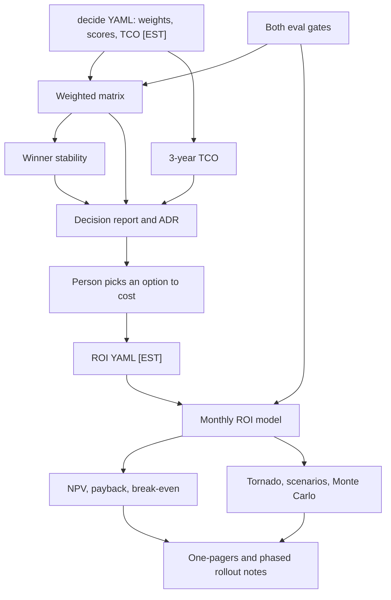

Illustrative numbers, replace with your own

# AI use-case ROI and build-vs-buy

One local calculator, two steps, then a rollout that stays in shadow. First you score build against buy (weights, a 3-year cash model, and how easily the winner flips). Then you put the option you are leaning toward through a monthly ROI: payback, break-even, NPV, tornado, scenarios, Monte Carlo. A person reads both files before anyone changes a process. Default path: no model call, no vendor call, no network. Cost to run: 0 USD.

The distribution name is `ai-use-case-roi-and-build-vs-buy`. The import package is `roi_and_build_vs_buy`, version 0.2.0. The command is `python -m roi_and_build_vs_buy` with subcommands `decide` and `roi`.

## Problem and result

A build-versus-buy slide hides two questions: which option scores highest once control, risk, and exit are weighted, and which option is cheaper over three years. A token price then hides a third question: after review time, residual errors, a fixed monthly cost, and a slow ramp, does the sketch pay back. Those answers can diverge.

**Calculated result, from illustrative inputs:** on the fictional Bruma Freight case, winner stability is **67.86%**. That is 19 of 28 feasible weight shifts keeping `build` in first place.

- Date: 2026-10-17
- Version: `roi_and_build_vs_buy` 0.2.0
- Python: 3.12.3
- Command: `ROI_ENABLE_REAL_PROVIDER=0 DECIDE_REAL_PROVIDER=0 python3 -m roi_and_build_vs_buy.evalkit`
- Output: JSON field `cases[0].winner_stability_pct` = `"67.86"`

How to read 67.86%: the tool nudges one illustrative weight at a time by 0.05 or 0.10, drops shifts that would push a weight outside 0.01–0.90, rescales the rest so they still sum to 1, and counts how often `build` stays first. 19 of those 28 shifts keep `build`. The percentage is not a probability that building is the right choice, and it is not a success rate from a live desk. Cedro Records stays at 100.00% on the same grid (28 of 28).

**Simulated ROI, same date, same package:** command `ROI_ENABLE_REAL_PROVIDER=0 ROI_PROVIDER=template ROI_MC_DRAWS=2000 ROI_SEED=42 python3 -m roi_and_build_vs_buy roi publish-docs` finished in 0.751 seconds and printed a 3-year NPV of **USD 180,923.12** for the fictional refund desk. Inputs are illustrative [EST]. The NPV is simulated. The pessimistic scenario never pays back (NPV USD -350,556.83). Full precision is in `docs/results/refund_desk.json`.

Replace the inputs before you treat either figure as your decision. See [docs/REPLACE_THE_ASSUMPTIONS.md](docs/REPLACE_THE_ASSUMPTIONS.md).

## Demo

```bash
python3 -m roi_and_build_vs_buy decide report --case examples/bruma_freight --out out/bruma-freight-report.md
ROI_ENABLE_REAL_PROVIDER=0 ROI_PROVIDER=template python3 -m roi_and_build_vs_buy roi demo
```

`make demo` runs both. If `make` is missing, the commands above are enough. Cost of the demo is zero.

## Business case

On Bruma Freight the weighted winner is `build` and the lowest operating total is `vendor_b`. The simulated [EST] 3-year operating gap is 57,316.07 USD (build 129,433.40, vendor_b 72,117.33). Including the modeled exit fee, the same pair differs by 2,683.93 USD the other way. Those dollars are simulated.

On the fictional refund-desk assumptions the sketch shows about USD 12,775 of net monthly savings in steady state and a payback of about 17 months [EST inputs, simulated output]. The pessimistic set never pays back. See [docs/BUSINESS_CASE.md](docs/BUSINESS_CASE.md).

## Architecture



Detail: [docs/architecture.md](docs/architecture.md).

## Results

Decision figures below are calculated from illustrative [EST] inputs on 2026-10-17, package 0.2.0, Python 3.12.3, command `ROI_ENABLE_REAL_PROVIDER=0 DECIDE_REAL_PROVIDER=0 python3 -m roi_and_build_vs_buy.evalkit`. That command checks the calculator. It does not score an assistant. ROI figures are simulated outputs of `ROI_ENABLE_REAL_PROVIDER=0 ROI_PROVIDER=template ROI_MC_DRAWS=2000 ROI_SEED=42 python3 -m roi_and_build_vs_buy roi publish-docs` (wall time 0.751 seconds). Nothing here is a vendor price.

### Build versus buy

| Case | Winner | Score [EST] | Winner stability | Rank stability | Scenarios |
| --- | --- | ---: | ---: | ---: | ---: |
| Bruma Freight support agent | `build` | 3.7000 | 67.86% | 67.86% | 28 |
| Cedro Records document assistant | `build` | 4.3600 | 100.00% | 100.00% | 28 |

Bruma Freight base cash (simulated, [EST], horizon 3, input date 2026-10-17). Same numbers as `docs/examples/bruma-freight-report.md`.

| Option | Weighted score [EST] | 3-year operating USD [EST] | 3-year USD with exit [EST] | Build crossover |
| --- | ---: | ---: | ---: | --- |
| `build` | 3.7000 | 129433.40 | 129433.40 | — |
| `vendor_a` Harborline Desk | 3.6200 | 175259.79 | 203259.79 | operating year 2 |
| `vendor_b` Quayloop | 3.0200 | 72117.33 | 132117.33 | operating: none; with exit: year 3 |

Smallest one-at-a-time flip on Bruma Freight: raising the time-to-value weight by 0.031 (from 0.20 to 0.231) makes `vendor_a` the winner.

Cedro Records base cash, same dating and labels:

| Option | Weighted score [EST] | 3-year operating USD [EST] | 3-year USD with exit [EST] | Build crossover |
| --- | ---: | ---: | ---: | --- |
| `build` | 4.3600 | 80751.76 | 80751.76 | — |
| `vendor_a` Folio Cloud | 3.4200 | 107428.39 | 127428.39 | operating year 2 |
| `vendor_b` Parchment Lane | 2.3800 | 54776.98 | 99776.98 | operating: none; with exit: year 3 |

On both cases the weighted winner is `build` and the lowest operating total is `vendor_b`.

Local timing of the decision report, not model latency: 30 sequential runs of `python3 -m roi_and_build_vs_buy decide report --case examples/bruma_freight --out /tmp/lat-N.md` on 2026-10-17, package 0.2.0, Python 3.12.3, sorted, index `round(p/100*(n-1))` (indexes 14 and 28). Result: p50 0.152 s, p95 0.158 s.

### Fictional refund desk (Puerto Gris Parcel Co.)

| Metric | Base | Pessimistic | Optimistic |
| --- | --- | --- | --- |
| Net monthly savings, steady state | USD 12,775.15 | USD -1,700.00 | USD 31,982.79 |
| Payback | 17.08 months | never | 3.85 months |
| 3-year NPV | USD 180,923.12 | USD -350,556.83 | USD 874,596.57 |
| Break-even volume | 412.43 items/month | none | (see JSON) |
| Cost per completed item, with review | USD 1.34 | | |
| Quality-adjusted savings per item | USD 6.06 | | |
| Residual error cost per item | USD 0.50 | | |
| Illustrative agent cost per run | USD 0.0051 | | |

Monte Carlo, 2000 draws, seed 42, base ranges (simulated):

| | P10 | P50 | P90 |
| --- | --- | --- | --- |
| 3-year NPV | USD -5,178.08 | USD 167,292.34 | USD 380,101.33 |
| Net monthly | USD 7,382.58 | USD 12,884.66 | USD 20,553.62 |

Largest one-at-a-time NPV swings: `volume_per_day`, `manual_minutes_per_item`, `loaded_cost_per_hour`.

### Personal example: weekly report

| Metric | Base | Pessimistic | Optimistic |
| --- | --- | --- | --- |
| Net monthly savings | USD 168.96 | USD -67.71 | USD 524.96 |
| Payback | 1.78 months | never | 0.57 months |
| 3-year NPV | USD 5,114.00 | USD -2,469.59 | USD 16,521.42 |

The pessimistic personal case is "your hour is cheap and you still spend an hour reviewing". The base case is not a recommendation to buy a subscription.

### Gate

| Check | Result | Command | Date |
| --- | --- | --- | --- |
| Unit tests | 80 passed, coverage 91.02% | `python3 -m pytest` | 2026-10-17 |
| Both eval gates | passed (exit 0), printed `BOTH EVAL GATES PASSED` | `ROI_ENABLE_REAL_PROVIDER=0 DECIDE_REAL_PROVIDER=0 python3 -m roi_and_build_vs_buy.evalkit` | 2026-10-17 |
| Forced ROI regression | exit 1, savings identity and break-even failed | `ROI_ENABLE_REAL_PROVIDER=0 python3 -m roi_and_build_vs_buy.evalkit.roi_regression` | 2026-10-17 |
| Forced decision regression | exit 1, `golden_winner: expected build got vendor_b`, stability 59.09 below 67.86 | `DECIDE_REAL_PROVIDER=0 python3 -m roi_and_build_vs_buy.evalkit.decide_regression` | 2026-10-17 |
| Secret scan | `{"ok": true, "findings": 0}` | `python3 -m roi_and_build_vs_buy.secretscan .` | 2026-10-17 |
| Types | no issues in 55 source files | `python3 -m mypy` | 2026-10-17 |

Python 3.12.3, package 0.2.0. The 59.09% line is the same calculator on illustrative weights edited on purpose. It is not an assistant failing a task.

## Use cases, governance and business strategy

### 1. Use cases

Client-style rows use a fictional organisation. Personal rows are sketches. Status is explicit.

| Use case | Status | Problem | Who approves | Gated effects | How this repo handles it |
| --- | --- | --- | --- | --- | --- |
| Support-agent build vs buy, Bruma Freight (fictional) | Implemented | A freight desk wants drafts for shipment-exception tickets and has to choose build, Vendor A, or Vendor B | The decision owner accepts or rejects the ADR. The CLI cannot accept it | None. The kit writes Markdown | `examples/bruma_freight`, `decide report`, [ADR bvb-0002](docs/adr/bvb-0002-bruma-freight-support-agent.md) |
| Document assistant, Cedro Records (fictional) | Implemented | An archive cooperative wants cited answers from internal binders | The decision owner accepts or rejects the ADR | None. No index is built | `examples/cedro_records`, [ADR bvb-0003](docs/adr/bvb-0003-cedro-records-document-assistant.md) |
| Refund back-office agent ROI at Puerto Gris Parcel Co. (fictional) | Implemented | Manual refund decisions are slow; review and residual errors can eat the gain | A person reading the assumptions. The model never approves | No external action. The report is a file | `assumptions/refund_desk.yaml`, monthly model, one-pagers |
| Should I automate my weekly report? | Implemented as a personal example | An hour of writing versus a draft you still read | You. The model does not subscribe to anything | No purchase, no send | `assumptions/weekly_report.yaml` |
| Contact-center deflection economics | Design only | Handle time, reopen rate, and the cost of a bad deflection are not in this repo | Would be the operations owner | Would gate any routing change. Not built | Named in `docs/SCOPE.md`. No runnable case |
| Document-processing agent ROI | Design only | Page volume and exception rate have to be calibrated per document type | Would be the process owner | Would gate writes into a system of record. Not built | Named only |
| Voice-agent platform selection | Design only | Telephony adds latency, number ownership, and recording | Would still be a named decision owner | Placing a call, buying a number | [docs/design-only/voice-agent-platform.md](docs/design-only/voice-agent-platform.md) |
| AI coding assistant for a side project | Design only | A person choosing a coding assistant for their own repo | The person | Account spend, repository access | [docs/design-only/personal-coding-assistant.md](docs/design-only/personal-coding-assistant.md) |
| DIY vs SaaS for a personal automation | Design only | A personal recurring task that could be a script or a subscription | The person | Sending messages, paying a subscription | [docs/design-only/personal-automation.md](docs/design-only/personal-automation.md) |
| Cost of my own AI subscriptions versus benefit | Design only | A subscription is a fixed cost; the benefit depends on which tasks move | You | Would not charge a card. Not built | `monthly_run_cost` in the weekly example is an [EST] slice, not a plan price |

### 2. Governance checklist

| Control | Where |
| --- | --- |
| ROI inputs are illustrative, each with `illustrative: true` and a rationale that contains `[EST]` | `assumptions/*.yaml`, `src/roi_and_build_vs_buy/roi/assumptions.py`, shared tag in `src/roi_and_build_vs_buy/assumptions.py` |
| Decision weights sum to 1; scores are integers 1–5 with a rationale | `src/roi_and_build_vs_buy/build_vs_buy/matrix.py`, checked again in `src/roi_and_build_vs_buy/evalkit/decide_gate.py` |
| Every TCO number has source, date, and estimate; a USD figure marked real without an https URL is rejected | `src/roi_and_build_vs_buy/build_vs_buy/prices.py` |
| Cases are marked fictional | `load_case`, `load_weights`, `load_tco` |
| Human approval | Reports say the tools do not approve. Decision ADRs stay `proposed`. There is no approve command |
| Traceability | JSON logs (`logging_setup.py`); JSONL traces (`evalkit/trace.py`); inputs and generated ADRs in git. One-pagers name the command, version, and generation time |
| Risks | [docs/RISKS.md](docs/RISKS.md) |
| Costs | [docs/COST.md](docs/COST.md) |
| Incident and rollback | [docs/RUNBOOK.md](docs/RUNBOOK.md) |
| Invariants instead of scripted tool paths | `evalkit/roi_invariants.py` and `evalkit/decide_gate.py` |
| Paid calls cannot happen in CI | `ROI_ENABLE_REAL_PROVIDER` and `DECIDE_REAL_PROVIDER` default to 0. The ROI real provider has no HTTP client. The decision eval ignores the real-provider flag and uses a cassette. Tests block sockets |
| Secrets | `src/roi_and_build_vs_buy/secretscan.py`, `.env.example`, `.gitignore`. Prefix shapes include `xai-`, `sk-` (also `sk-proj-`), `sk-ant-`, `sk_`, `ghp_`, `github_pat_`, `AKIA`, a `Bearer` token, and private-key headers |
| Forced red gates | `make eval-regression` exits 1 only when both forced regressions fail. CI treats a zero from that target as a failure |

Not covered yet: live data connectors, a dashboard, identity for a multi-user app, a production quote feed, tax, currency conversion, queueing, and any link to a production ledger.

### 3. Business strategy

The path is a decision, then a business case, then a phased rollout. Discovery comes first ([docs/DISCOVERY.md](docs/DISCOVERY.md)), not a model name.

Phase 0, implemented here: score build versus buy on one workflow, write the ADR, and run the monthly ROI on the option you would actually fund. Both stay in shadow. The files sit next to the current process and do not change it.

Phase 1, design only: replace `[EST]` inputs with measurements, one field at a time, and keep the old file in git. A connector, if one is added later, would refresh a YAML that a person still commits.

Phase 2, design only: a dashboard or a live effect (sending a reply, moving a ticket, placing a call). That needs an owner and a human gate. Nothing in this repository is that gate.

A person owns the assumption files. Finance owns the discount rate and any real price. The process owner owns review rate, error cost, seats, and exit. This repo does not own a production decision. Scope is in [docs/SCOPE.md](docs/SCOPE.md). Success metrics are in [docs/METRICS.md](docs/METRICS.md).

## Decisions

ROI:

- [ADR 0001](docs/adr/0001-monthly-pure-python.md) — monthly model, pure Python
- [ADR 0002](docs/adr/0002-quality-adjusted-savings.md) — quality-adjusted savings
- [ADR 0003](docs/adr/0003-break-even-is-operating-volume.md) — break-even is operating volume
- [ADR 0004](docs/adr/0004-invariants-and-providers-off.md) — invariants, providers off
- [ADR 0005](docs/adr/0005-xlsx-formulas-and-csv.md) — formulas in XLSX, values in CSV
- [ADR 0006](docs/adr/0006-assumption-file-is-the-source.md) — the YAML file is the only numeric source

Build versus buy (filenames are prefixed so they do not collide with the ROI ADRs; the ids inside the generated files stay 0002 and 0003):

- [Template](docs/adr/bvb-0001-build-vs-buy-template.md)
- [Bruma Freight](docs/adr/bvb-0002-bruma-freight-support-agent.md)
- [Cedro Records](docs/adr/bvb-0003-cedro-records-document-assistant.md)
- [Invariant evals and dated prices](docs/adr/bvb-0004-invariant-evals-and-dated-prices.md)

## Security and known limits

### What this does NOT do

- It does not call a model vendor. `ROI_ENABLE_REAL_PROVIDER=1` still has no HTTP client. `DECIDE_REAL_PROVIDER=1` is off, and the eval path does not construct the HTTP adapter.
- It does not read a CRM, a ticket queue, a ledger, or a price page.
- It does not prove a production ROI, a payback a company achieved, or a platform choice a company made.
- It does not use client, employer, or personal data. Names in the examples are fictional.
- It does not approve a purchase, a refund, a routing change, a subscription, or a vendor contract.
- It does not provide a dashboard.
- It does not model tax, depreciation schedules, currency, or hiring delays beyond the ramp fraction and the build-overrun scenario.
- It does not evaluate Excel formulas inside CI. The workbook is live when you open it in a spreadsheet.

### Design-only vs implemented

| Piece | State |
| --- | --- |
| Weighted matrix, winner stability, 3-year TCO, scenarios, break-even year, CLI reports | Implemented |
| Bruma Freight and Cedro Records, generated reports and ADRs | Implemented |
| Monthly NPV, payback, break-even, unit cost, quality adjustment | Implemented |
| Tornado, pessimistic/base/optimistic, seeded PERT/triangular Monte Carlo | Implemented |
| CSV, formula XLSX, Markdown, HTML, inline SVG, EN/ES one-pagers | Implemented |
| Two invariant gates and two forced regressions | Implemented |
| Shared `[EST]` tag, one secretscan, one logger, one retry module, one trace | Implemented |
| Measured 23-case eval bill | Recorded in `assumptions/measured_eval_run_cost.yaml` and not applied to the invented inputs |
| Contact-center deflection, document-processing ROI, personal subscription versus benefit | Design only |
| Voice platform, personal coding assistant, personal automation | Design only |
| Live connectors, dashboards, procurement, questionnaire automation | Design only. Checklist: [docs/security-questionnaire-checklist.md](docs/security-questionnaire-checklist.md) |

## How to reproduce

Cost of the default path: **zero**. No API key. No network in tests.

```bash
python3 -m pip install -e ".[dev]"
python3 -m ruff check . && python3 -m ruff format --check .
python3 -m mypy
python3 -m pytest
ROI_ENABLE_REAL_PROVIDER=0 DECIDE_REAL_PROVIDER=0 python3 -m roi_and_build_vs_buy.evalkit
ROI_ENABLE_REAL_PROVIDER=0 python3 -m roi_and_build_vs_buy.evalkit.roi_regression          # must exit 1
DECIDE_REAL_PROVIDER=0 python3 -m roi_and_build_vs_buy.evalkit.decide_regression       # must exit 1
ROI_ENABLE_REAL_PROVIDER=0 ROI_PROVIDER=template python3 -m roi_and_build_vs_buy roi demo
python3 -m roi_and_build_vs_buy decide report --case examples/bruma_freight --out out/bruma-freight-report.md
python3 -m roi_and_build_vs_buy.secretscan .
```

`make setup`, `make lint`, `make typecheck`, `make test`, `make eval`, `make eval-regression`, `make demo`, and `make secrets` call those commands. `make eval-regression` exits 1 when both forced regressions fail, and exits 0 when either one passes. CI treats that zero as a failure. Make may be absent; the `python3 -m` lines are enough.

Configuration is environment-only. See `.env.example`. This program does not auto-load a `.env` file.

## Next steps

- Replace illustrative `[EST]` inputs with measurements, one field at a time. Steps: [docs/REPLACE_THE_ASSUMPTIONS.md](docs/REPLACE_THE_ASSUMPTIONS.md). Adapting both modules to a real client: [docs/ADAPT_TO_A_REAL_CLIENT.md](docs/ADAPT_TO_A_REAL_CLIENT.md).
- The measured 23-case eval bill is not a per-item cost. A per-item override is a different file with `status: measured` and `roi run --measured-cost`. Do not paste a price-page number and call it measured.
- Design-only cases stay out of the result tables until their parameters exist.
- A dashboard, a live connector, or a quote feed is a later phase.

## Docs

- [docs/HOW_IT_WORKS.md](docs/HOW_IT_WORKS.md) — walkthrough in rioplatense Spanish
- [docs/BUSINESS_CASE.md](docs/BUSINESS_CASE.md)
- [docs/DISCOVERY.md](docs/DISCOVERY.md)
- [docs/SCOPE.md](docs/SCOPE.md)
- [docs/RISKS.md](docs/RISKS.md)
- [docs/METRICS.md](docs/METRICS.md)
- [docs/COST.md](docs/COST.md)
- [docs/RUNBOOK.md](docs/RUNBOOK.md)
- [docs/architecture.md](docs/architecture.md)
- [docs/ADAPT_TO_A_REAL_CLIENT.md](docs/ADAPT_TO_A_REAL_CLIENT.md)
- [docs/REPLACE_THE_ASSUMPTIONS.md](docs/REPLACE_THE_ASSUMPTIONS.md)
- [docs/PROVENANCE.md](docs/PROVENANCE.md)
- [docs/ONE_PAGER_EN.md](docs/ONE_PAGER_EN.md), [docs/ONE_PAGER_ES.md](docs/ONE_PAGER_ES.md)
- [docs/examples/bruma-freight-report.md](docs/examples/bruma-freight-report.md), [docs/examples/cedro-records-report.md](docs/examples/cedro-records-report.md)
