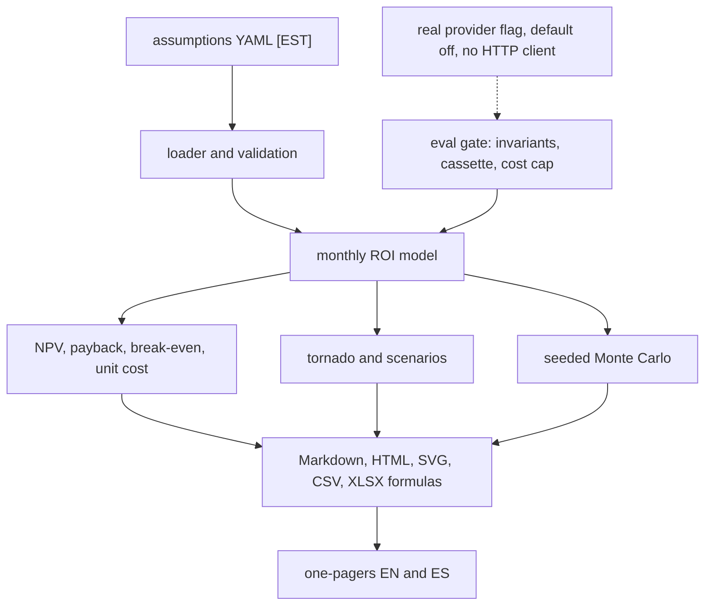

# AI use-case ROI model

A local Python calculator for ROI, payback, break-even and sensitivity of one AI use case. What is tested is the formula: savings identity, break-even, explicit payback, monotonicity in volume, a seeded Monte Carlo, and a gate that must go red when the formula is wrong. It does not test a live model and it does not measure a real business.

## Problem and result

A team can talk itself into an agent because the token price looks small and the manual process looks slow. The review time, the errors that remain, the fixed monthly cost and a slow ramp are easy to leave out. This repo puts those pieces in one monthly model so a person can see whether the sketch pays back.

Measured program output, not a business result: on 2026-10-17, package 0.1.0, Python 3.12.3, command `ROI_ENABLE_REAL_PROVIDER=0 ROI_PROVIDER=template ROI_MC_DRAWS=2000 ROI_SEED=42 python -m roi_model.cli publish-docs` finished in 0.703 seconds and printed a 3-year NPV of **USD 180,923.12** for the fictional refund desk. Inputs are [EST]. The NPV is simulated. The same command's pessimistic scenario never pays back (NPV USD -350,556.83). Full precision is in `docs/results/refund_desk.json`.

## Demo

```bash
ROI_ENABLE_REAL_PROVIDER=0 ROI_PROVIDER=template python -m roi_model.cli demo
```

`make demo` is the same command. Outputs land in `out/refund-desk/` and `out/weekly-report/`. Cost of the demo is zero: no API key and no network call.

## Business case

On the fictional base assumptions the refund desk sketch shows about USD 12,775 of net monthly savings in steady state and a payback of about 17 months [EST inputs, simulated output]. The pessimistic set never pays back. That spread is the point of the model: the base case is not a decision. See [docs/BUSINESS_CASE.md](docs/BUSINESS_CASE.md).

## Architecture



## Results

All figures below are simulated outputs of package 0.1.0 on 2026-10-17. Command: `ROI_ENABLE_REAL_PROVIDER=0 ROI_PROVIDER=template ROI_MC_DRAWS=2000 ROI_SEED=42 python -m roi_model.cli publish-docs`. Python 3.12.3. Wall time for that command: 0.703 seconds. Inputs are [EST]. Nothing here is a vendor price.

### Fictional refund desk (Puerto Gris Parcel Co.)

| Metric | Base | Pessimistic | Optimistic |
| --- | --- | --- | --- |
| Net monthly savings, steady state | USD 12,775.15 | USD -1,700.00 | USD 31,982.79 |
| Payback | 17.08 months | never | 3.85 months |
| 3-year NPV | USD 180,923.12 | USD -350,556.83 | USD 874,596.57 |
| Break-even volume | 412.43 items/month | none | (see JSON) |
| Cost per completed item, with review | USD 1.34 | | |
| Quality-adjusted savings per item | USD 6.06 | | |
| Residual error cost per item | USD 0.50 | | |
| Illustrative agent cost per run | USD 0.0051 | | |

Monte Carlo, 2000 draws, seed 42, base ranges (simulated):

| | P10 | P50 | P90 |
| --- | --- | --- | --- |
| 3-year NPV | USD -5,178.08 | USD 167,292.34 | USD 380,101.33 |
| Net monthly | USD 7,382.58 | USD 12,884.66 | USD 20,553.62 |

Largest one-at-a-time NPV swings: `volume_per_day`, `manual_minutes_per_item`, `loaded_cost_per_hour`.

### Personal example: weekly report

| Metric | Base | Pessimistic | Optimistic |
| --- | --- | --- | --- |
| Net monthly savings | USD 168.96 | USD -67.71 | USD 524.96 |
| Payback | 1.78 months | never | 0.57 months |
| 3-year NPV | USD 5,114.00 | USD -2,469.59 | USD 16,521.42 |

The pessimistic personal case is "your hour is cheap and you still spend an hour reviewing". The base case is not a recommendation to buy a subscription.

### Gate

| Check | Result | Command | Date |
| --- | --- | --- | --- |
| Unit tests | 36 passed, coverage 92.85% | `python -m pytest` | 2026-10-17 |
| Eval gate | passed (exit 0) | `python -m roi_model.evalkit` | 2026-10-17 |
| Forced regression | failed as required (exit 1) | `python -m roi_model.evalkit.regression` | 2026-10-17 |
| Secret scan | no findings | `python -m roi_model.secretscan` | 2026-10-17 |

## Use cases, governance and business strategy

### 1. Use cases

Client-style cases use a fictional company or no company. They are patterns, not engagements.

| Use case | Status | Problem | Who approves | Gated effects | How this repo handles it |
| --- | --- | --- | --- | --- | --- |
| Refund back-office agent ROI at Puerto Gris Parcel Co. (fictional) | Implemented | Manual refund decisions are slow; an agent draft might save time, but review and residual errors can eat the gain | A person reading the assumptions. The model never approves | No external action. The report is a file | `assumptions/refund_desk.yaml`, monthly model, tornado, scenarios, Monte Carlo, one-pagers |
| Contact-center deflection economics | Design only | Whether a bot should deflect calls depends on handle time, reopen rate and the cost of a bad deflection. Those parameters are not in this repo | Would be the operations owner, not this program | Would gate any routing change. Not built | Named in this table and in `docs/SCOPE.md`. No runnable case and no fake result |
| Document-processing agent | Design only | Page volume, exception rate and reviewer minutes have to be calibrated per document type | Would be the process owner | Would gate downstream writes into a system of record. Not built | Named only. No parameters invented to look precise |
| Should I automate my weekly report? | Implemented as a personal example | An hour of writing versus a draft you still read | You. The model does not subscribe to anything | No purchase, no send | `assumptions/weekly_report.yaml` and `docs/ONE_PAGER_WEEKLY_ES.md` |
| Cost of my own AI subscriptions versus benefit | Design only | A subscription is a fixed cost; the benefit depends on which tasks actually move | You | Would not charge a card. Not built | Named only. `monthly_run_cost` in the weekly example is an [EST] slice, not a plan price |

### 2. Governance checklist

| Control | Where |
| --- | --- |
| Inputs are assumptions, each with a rationale that must contain `[EST]` | `assumptions/*.yaml`, `src/roi_model/assumptions.py` |
| Human approval | The report says the model does not approve. There is no approve command |
| Traceability | `trace.jsonl` on each run (`src/roi_model/trace.py`). One-pagers name the command, version and generation time |
| Risks | [docs/RISKS.md](docs/RISKS.md) |
| Costs | [docs/COST.md](docs/COST.md) |
| Incident and rollback | [docs/RUNBOOK.md](docs/RUNBOOK.md) |
| Invariants instead of scripted tool paths | `src/roi_model/evalkit/invariants.py` |
| Paid calls cannot happen in CI | `ROI_ENABLE_REAL_PROVIDER` defaults to 0. No vendor HTTP client is shipped. Tests block sockets |
| Secrets | `src/roi_model/secretscan.py`, `.env.example`, `.gitignore` |
| Forced red gate | `make eval-regression` exits 1. CI asserts that |

Not covered yet: live data connectors, a dashboard, identity and access for a multi-user app, a real vendor adapter, tax, currency conversion, queueing or SLA latency, and any link to a production ledger.

### 3. Business strategy

The business problem is a go / no-go sketch for one agent, before anyone buys a platform. The ROI model is [EST] on purpose: volume, minutes, loaded cost, error cost, review rate, ramp, implementation and the discount rate are assumptions until someone measures them. Scope and phases are in [docs/SCOPE.md](docs/SCOPE.md). Success metrics are in [docs/METRICS.md](docs/METRICS.md).

Deployment Strategist conversation: start with discovery ([docs/DISCOVERY.md](docs/DISCOVERY.md)), not with a model name. Run the calculator in shadow: the numbers sit next to the current process and do not change it. A person owns the assumption file, the finance partner owns the discount rate, and the process owner owns review rate and error cost. This repo does not own a production decision. A gate, if one is added later, would block any external action until that person approves. Nothing in this repository is that gate for a real client.

## Decisions

- [ADR 0001](docs/adr/0001-monthly-pure-python.md) — monthly model, pure Python
- [ADR 0002](docs/adr/0002-quality-adjusted-savings.md) — quality-adjusted savings
- [ADR 0003](docs/adr/0003-break-even-is-operating-volume.md) — break-even is operating volume
- [ADR 0004](docs/adr/0004-invariants-and-providers-off.md) — invariants, providers off
- [ADR 0005](docs/adr/0005-xlsx-formulas-and-csv.md) — formulas in XLSX, values in CSV
- [ADR 0006](docs/adr/0006-assumption-file-is-the-source.md) — the YAML file is the only numeric source

## Security and known limits

### What this does NOT do

- It does not call a model vendor, even if `ROI_ENABLE_REAL_PROVIDER=1` (no HTTP client is shipped).
- It does not read a CRM, a ticket queue, or a ledger.
- It does not prove a production ROI or a payback that a company achieved.
- It does not use client, employer, or personal data. Cases are fictional or personal sketches.
- It does not approve a purchase, a refund, a routing change, or a subscription.
- It does not provide a dashboard.
- It does not model tax, depreciation schedules, currency, or headcount hiring delays beyond the ramp fraction.
- It does not evaluate Excel formulas inside CI. The workbook is live when you open it in a spreadsheet.

### Design-only vs implemented

| Piece | State |
| --- | --- |
| Monthly NPV, payback, break-even, unit cost, quality adjustment | Implemented |
| Tornado, pessimistic/base/optimistic, seeded PERT/triangular Monte Carlo | Implemented |
| CSV, formula XLSX, Markdown, HTML, inline SVG | Implemented |
| EN/ES one-pagers for the refund desk and the weekly-report example | Implemented |
| Invariant eval gate and forced regression | Implemented |
| Measured per-run cost slot | Implemented as an input override. No measured figure is shipped |
| Contact-center deflection, document processing, personal subscription versus benefit | Design only |
| Live connectors and dashboards | Design only |

## How to reproduce

Cost of the default path: **zero**. No API key. No network in tests.

```bash
python3 -m pip install -e ".[dev]"
python3 -m ruff check . && python3 -m ruff format --check .
python3 -m mypy
python3 -m pytest
ROI_ENABLE_REAL_PROVIDER=0 python3 -m roi_model.evalkit
ROI_ENABLE_REAL_PROVIDER=0 python3 -m roi_model.evalkit.regression   # must exit 1
ROI_ENABLE_REAL_PROVIDER=0 ROI_PROVIDER=template python3 -m roi_model.cli demo
python3 -m roi_model.secretscan
```

`make setup`, `make lint`, `make typecheck`, `make test`, `make eval`, `make eval-regression`, `make demo`, and `make secrets` call those commands. Make may be absent; the `python -m` lines are enough.

Configuration is environment-only. See `.env.example`. This program does not auto-load a `.env` file.

## Next steps

- Replace [EST] inputs with measurements, one field at a time, and keep the old file in git.
- If a per-run cost is measured elsewhere, pass it with `--measured-cost` and a file whose status is `measured`. Do not paste a price-page number and call it measured.
- Design-only cases stay out of the result tables until their parameters exist.
- A dashboard or a live connector is a later phase, not a patch on this calculator.

## Docs

- [docs/HOW_IT_WORKS.md](docs/HOW_IT_WORKS.md) — walkthrough in rioplatense Spanish
- [docs/BUSINESS_CASE.md](docs/BUSINESS_CASE.md)
- [docs/DISCOVERY.md](docs/DISCOVERY.md)
- [docs/SCOPE.md](docs/SCOPE.md)
- [docs/RISKS.md](docs/RISKS.md)
- [docs/METRICS.md](docs/METRICS.md)
- [docs/COST.md](docs/COST.md)
- [docs/RUNBOOK.md](docs/RUNBOOK.md)
- [docs/architecture.md](docs/architecture.md)
- [docs/ADAPT_TO_A_REAL_CLIENT.md](docs/ADAPT_TO_A_REAL_CLIENT.md)
- [docs/ONE_PAGER_EN.md](docs/ONE_PAGER_EN.md), [docs/ONE_PAGER_ES.md](docs/ONE_PAGER_ES.md)
- [docs/PROVENANCE.md](docs/PROVENANCE.md)
